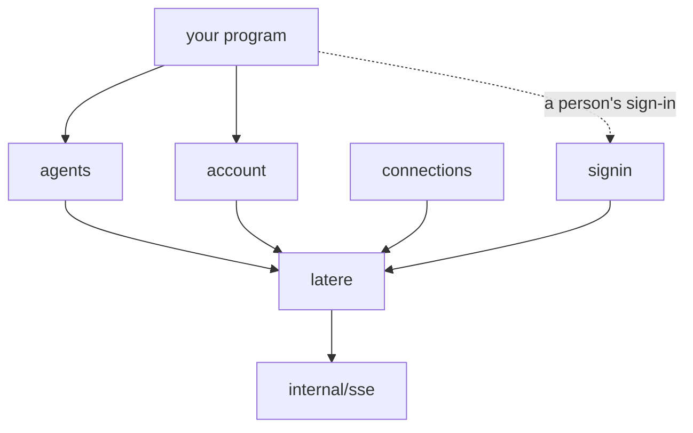

# How the SDK is designed

This page explains why the SDK is shaped the way it is. Read it before you
propose a change to how requests, retries, credentials, pages or streams
work; the README says how to use them.

## Goals

- **The standard library alone.** A program that imports the SDK pulls in
  no other module, so it adds nothing to a dependency review and cannot
  conflict with the versions a program already uses.
- **One package per capability.** A program imports `agents` without
  compiling the code for storage or apps, and each package's docs read on
  their own.
- **No global state.** Everything a request needs comes from a
  `latere.Config` the caller built; two configurations in one program do
  not affect each other.
- **A context on every call**, so a caller can cancel and bound any
  request, stream or list.

## Layout

`latere` is the core: configuration, credentials, the error type, the
request loop, pagination and streams. A capability package (`agents`,
`account`, and those to come) holds typed models and one method per
endpoint, and calls the API only through `Config.Do`, `Config.Stream` and
`latere.Items`. `signin` is separate because most programs, those that run
with a key, never sign a person in; the core does not import it.

A capability package's client is `New(cfg)`, with one method per endpoint
named verb first after the API's resource, as the AWS SDK names its
operations: `GetSession`, `ListSessions`, `CreateSession`, `GetWallet`. A
client exposes no service fields: a type has exported fields only when it
is plain data, such as a model or a request's parameters, or configuration
filled in once before use. A type with state, invariants or concurrent
use, such as a client, a configuration or a token source, keeps its fields
unexported behind a constructor and methods. Sharing one `Config` between
packages shares its HTTP client, credentials and retry policy.

A call on a `Config` that `NewConfig` did not build, a nil one included,
fails with an error saying so rather than panicking.

## Configuration

`latere.NewConfig` takes functional options, and an option can fail (a
malformed base URL, a negative retry count), so `NewConfig` returns an
error instead of panicking later. The token sources' constructors,
`NewKeyTokens` and `NewActorTokens`, do the same with their options. When
neither `WithKey` nor `WithTokenSource` is given, `NewConfig` reads
`LATERE_KEY`, and when `WithBaseURL` is absent it reads `LATERE_BASE_URL`;
an explicit option always wins over the environment.

Per-call options are not offered. A call that needs a shorter deadline
uses its context; a part of a program that needs another retry policy
builds a second `Config`.

## Credentials

Every request carries a bearer token from a `latere.TokenSource`, an
interface of one method, `Token(ctx)`. Three sources ship with the SDK:

- `NewKeyTokens` exchanges a key from the console for a short-lived token
  with the OAuth client credentials grant, which is what the API's
  authentication docs describe. `WithKey` builds one.
- `NewActorTokens` turns a person's sign-in into short-lived API tokens.
- `StaticToken` sends a token the caller already holds.

The two exchanging sources send their exchanges through the HTTP client,
User-Agent and hooks of the `Config` they are given to, so a proxy, a
trace or a log sees them as it sees the requests they sign.

`ReuseToken` wraps a source so that a token is reused until shortly before
it expires, and so that concurrent requests needing a new token cause one
fetch, not one each. The fetch runs detached from the first caller's
context, so that if that caller gives up, the others still get the token,
and is bounded by `TokenTimeout` instead: a source that hangs fails the
callers waiting on it, and the next call asks again, rather than holding
every later request.

A source that also implements `Resetter` lets the core recover from a 401:
it drops its token, and the request is sent once more with a new one. A
401 means the API did not act on the request, so this retry is safe for
any method. A source's own failure is retried only when it may pass, on
the network or at an issuer that is down; a credential the issuer refuses
fails the call at once.

`golang.org/x/oauth2` would cover part of this, but it is a dependency,
and the API's token exchanges are small enough to write and test here.

## Requests and retries

`Config.Do` sends a request, decodes a 2xx answer into the caller's value,
and turns anything else into a `*latere.Error`.

A request is retried when the network failed or the API answered 408, 429,
500, 502, 503 or 504, and only when it is safe to send twice: a `GET`,
`HEAD`, `PUT`, `DELETE` or `OPTIONS`, or a request carrying an idempotency
key. Every method that creates or sends something sends an
`Idempotency-Key`, generated when the caller gives none, so retries never
create a second session or send a message twice. A repeat that arrives
while the first request is still being answered is refused with 409, which
the SDK does not retry, since it cannot tell it from a real conflict; the
first request still succeeds, and the docs tell the caller to read the
resource.

The wait between attempts doubles from 500ms up to 30s, and is drawn at
random from the upper half of that range so that many clients failing
together do not retry together. A `Retry-After` header replaces the
computed wait. A `Retry-After` longer than the longest backoff ends the
retries and returns the error with `RetryAfter` set, so the caller decides
whether to wait that long.

A call whose context has no deadline is bounded by `DefaultTimeout`, 80
seconds as in Stripe's SDK, or by `WithTimeout`, for the call and all of
its retries, including reading the answer: a server that stops answering
cannot hold a program forever. The caller's own deadline is the more
specific choice and replaces the bound. A stream is bounded only until the
API's first answer, by a timer rather than a deadline, since the stream
then lasts as long as the session. A call cut off by its context, during
an attempt or a wait between attempts, returns an error matching the
context's, joined with the last answer when there was one.

## Errors

The API refuses a request with a status and a JSON envelope of a code, a
message and details. The SDK returns all of it in one type,
`*latere.Error`, together with the request id from `X-Request-Id`, which is
what support needs to find the request. `Error.Is` maps statuses to
sentinels (`ErrNotFound`, `ErrUnauthorized`, `ErrForbidden`, `ErrConflict`,
`ErrRateLimited`), so the common checks need `errors.Is` and no type
assertion. An answer that is not the envelope still produces an `Error`,
with the body's start or the status text as its message.

## Pagination

A list endpoint answers a page of items and a cursor for the next one.
Each list method comes in two forms: `List` returns an `iter.Seq2[T, error]`
that fetches pages while the loop asks for items, and `ListPage` returns
one page for a caller that keeps the cursor itself, between requests of a
web app for instance. The iterator stops at an empty cursor and also at a
cursor equal to the last one, so a server answering the same page forever
cannot hang a loop.

## Streams

A session's events are a log with sequence numbers, served as server-sent
events whose `id` is the sequence. `Config.Stream` reads the frames, and
when the connection drops it reconnects with `Last-Event-ID` set to the
last frame it delivered, so the caller sees every event once, in order,
without writing reconnect code. A reconnect that reads no frame counts
against the retry limit; one that reads frames resets the count, so a long
stream survives many drops spread over hours. When the caller stops the
loop, the stream's body is closed without reading what is left, since a
live stream never ends on its own: draining it would wait for the next
keepalive, or forever, and hold one of the streams the API allows a
caller.

A frame is read whole, up to `sse.MaxLine`, 16 MiB, twice the largest body
the API takes. A larger one ends the stream with an error instead of a
reconnect, which would only read it again.

Whether a frame ends the stream is the capability's knowledge, not the
core's, so `Stream` takes a `done` predicate: `agents.StreamEvents` ends a
session's stream after the status event that says the session ended. Frames without
an id, such as the deltas of a response being written, are delivered but
do not move the resume point, because the server does not replay them.

## Models

The request and response types are written by hand. The agents API's
document describes its answers by examples rather than schemas, which
leaves a generator nothing to generate from, and hand-written types let the
docs say what each field means to a caller rather than repeat the schema.

The tests hold the types to the API's documents, vendored as JSON in
`openapi/`: a field a model reads must appear in the document's examples or
schema, a field the schema requires must be in the model, and every
endpoint a package calls must exist. A field left out on purpose is listed,
with its reason, in the package's `spec_test.go`, and a field the schema
marks as a date-time must be a `time.Time`. The program that fetches
and converts the documents lives in its own module under `tools/`, so the
YAML parser it needs never reaches the SDK's `go.mod`. A weekly workflow
fetches the documents and fails when they changed, which is the signal to
update the models.

## Observability

The SDK sends every request through the `*http.Client` it was given, so
tracing and metrics come from an instrumented transport, such as
OpenTelemetry's `otelhttp`, without the SDK depending on a telemetry
library. `WithHooks` adds two callbacks around each attempt, retries
included, for logging or counting what a transport cannot see, such as how
long an attempt took before a retry.

## Signing a person in

`signin` implements the two OAuth flows a native program uses. `Browser`
listens on a loopback port, sends the person to the sign-in page with a
PKCE challenge and a random state, and exchanges the code that comes back;
a return with the wrong state is refused and the flow keeps waiting for
the real one. `Device` shows a code for the person to enter on another
device and polls until they do, slowing down when the service asks.
`TokenSource` keeps a sign-in fresh with its refresh token and hands the
new token to a callback, so a program can store it where it keeps
secrets. Programs that only use keys never import the package.

Both flows need a client that Latere registers, with the API among its
audiences, until registration is self-service; the package documentation
says how to ask for one and what to register.

## What came from other SDKs

The design borrows from three widely used Go SDKs:

- **AWS SDK for Go v2:** one shared configuration handed to a client per
  service, operations as methods named verb first on that client, and
  exponential backoff with jitter. Not taken: the middleware
  stack, which is more machinery than an API of this size needs.
- **Stripe's Go SDK:** lists as `iter.Seq2`, an idempotency key generated
  for every `POST`, the request id on every error, two retries by default,
  and an 80-second default timeout. Not taken: the package-level key and backends,
  which are global state.
- **Anthropic's Go SDK:** retrying only requests that can be replayed,
  retrying on 408, 429 and 5xx answers, honoring `Retry-After`, and a
  server-sent events stream consumed as an iterator. Not taken: optional
  parameter wrapper types and per-call request options; plain structs with
  `omitempty` fields and a context cover this API.

## Versioning

The SDK is at v0, and a minor version may break code; each break is marked
in the changelog. Once at v1 it follows semantic versioning, and a change
that breaks code needs a new major version under its own module path.
