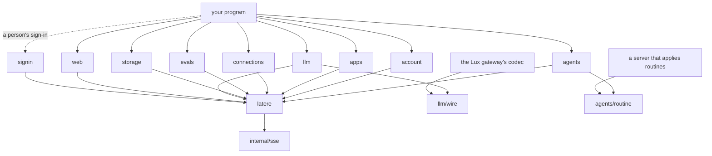

# How the SDK is designed

This page explains why the SDK is shaped the way it is. Read it before you
propose a change to how requests, retries, credentials, pages or streams
work; the README says how to use them.

## Goals

- **The standard library alone.** A program that imports the SDK pulls in
  no other module, so it adds nothing to a dependency review and cannot
  conflict with the versions a program already uses.
- **One package per capability.** A program imports `agents` without
  compiling the code for storage or apps, and each package's docs read on
  their own.
- **No global state.** Everything a request needs comes from a
  `latere.Config` the caller built; two configurations in one program do
  not affect each other.
- **A context on every call**, so a caller can cancel and bound any
  request, stream or list.

## Layout

`latere` is the core: configuration, credentials, the error type, the
request loop, pagination and streams. A capability package (`agents`,
`account`, `apps`, `connections`, `evals`, `llm`, `storage`, `web`, and those to come) holds typed
models and one method per endpoint, and calls the API only through
`Config.Do`, `Config.Open`, `Config.Stream` and `latere.Items`. `signin` is separate
because most programs, those that run with a key, never sign a person in;
the core does not import it.

A capability package's client is `New(cfg)`, with one method per endpoint
named verb first after the API's resource, as the AWS SDK names its
operations: `GetSession`, `ListSessions`, `CreateSession`, `GetWallet`. A
client exposes no service fields: a type has exported fields only when it
is plain data, such as a model or a request's parameters, or configuration
filled in once before use. A type with state, invariants or concurrent
use, such as a client, a configuration or a token source, keeps its fields
unexported behind a constructor and methods. Sharing one `Config` between
packages shares its HTTP client, credentials and retry policy.

A call on a `Config` that `NewConfig` did not build, a nil one included,
fails with an error saying so rather than panicking.

## Configuration

`latere.NewConfig` takes functional options, and an option can fail (a
malformed base URL, a negative retry count), so `NewConfig` returns an
error instead of panicking later. The token sources' constructors,
`NewKeyTokens` and `NewActorTokens`, do the same with their options. When
neither `WithKey` nor `WithTokenSource` is given, `NewConfig` reads
`LATERE_KEY`, and when `WithBaseURL` is absent it reads `LATERE_BASE_URL`;
an explicit option always wins over the environment.

Per-call options are not offered. A call that needs a shorter deadline
uses its context; a part of a program that needs another retry policy
builds a second `Config`.

## Credentials

Every request carries a bearer token from a `latere.TokenSource`, an
interface of one method, `Token(ctx)`. Three sources ship with the SDK:

- `NewKeyTokens` exchanges a key from the console for a short-lived token
  with the OAuth client credentials grant, which is what the API's
  authentication docs describe. `WithKey` builds one.
- `NewActorTokens` turns a person's sign-in into short-lived API tokens.
- `StaticToken` sends a token the caller already holds.

The two exchanging sources send their exchanges through the HTTP client,
User-Agent and hooks of the `Config` they are given to, so a proxy, a
trace or a log sees them as it sees the requests they sign.

`ReuseToken` wraps a source so that a token is reused until shortly before
it expires, and so that concurrent requests needing a new token cause one
fetch, not one each. The fetch runs detached from the first caller's
context, so that if that caller gives up, the others still get the token,
and is bounded by `TokenTimeout` instead: a source that hangs fails the
callers waiting on it, and the next call asks again, rather than holding
every later request.

A source that also implements `Resetter` lets the core recover from a 401:
it drops its token, and the request is sent once more with a new one. A
401 means the API did not act on the request, so this retry is safe for
any method. A source's own failure is retried only when it may pass, on
the network or at an issuer that is down; a credential the issuer refuses
fails the call at once.

A route that reads no credential is sent with `Request.Anonymous`, which
fetches no token and sends none: a site's icon is the site's and no one's,
so `web.GetIcon` sends nothing that would tie the sites a person reads to
them, as Latere Chat reads icons, and it works whether or not the
credentials do. A 401 to such a request is answered as it is, since no
token was sent to renew.

Other public reads take a credential when there is one: a conversation's
share answers a member of an organization what a link for members shows,
and an app's owner reads its private pictures. A method for those sends
the `Config`'s credential as any other does, and a program that holds
none, such as a server rendering a shared page for a visitor, builds its
`Config` with `WithoutCredentials`, which sends none on any request. The
two are kept apart rather than one inferred from the other: the route
decides `Request.Anonymous`, the program decides `WithoutCredentials`,
and one method serves both kinds of reader instead of a signed-out twin
of each. A request that sends the key is refused before it is sent under
either, since there is no key to send.

`golang.org/x/oauth2` would cover part of this, but it is a dependency,
and the API's token exchanges are small enough to write and test here.

A program handed a token to present to the API, such as one that serves
sessions on a person's computer, needs to know whom the token names and
when it expires before it presents it. `ReadUnverifiedClaims` reads that
from the token's payload and checks nothing; verifying a signature would
need the issuer's keys and a JOSE library, and the API verifies the token
anyway. "Unverified" is in the function's name and its result's type, so
no caller reads it as a check and no value of it passes for a verified
one.

## Requests and retries

`Config.Do` sends a request, decodes a 2xx answer into the caller's value,
and turns anything else into a `*latere.Error`.

A request is retried when the network failed or the API answered 408, 429,
500, 502, 503 or 504, and only when it is safe to send twice, which its
`RetryRule` says. The zero rule goes by the method: a `GET`, `HEAD`, `PUT`,
`DELETE` or `OPTIONS`, or a `POST` carrying an idempotency key. The API
reads `Idempotency-Key` on `POST` alone, so a key does not make any other
method safe to repeat; the rule is set on the request rather than inferred
from the key. A `PATCH` that only sets values, such as a session's title or
model, has the same effect sent twice and carries `RetryAlways`, as does
counting a request's tokens, which changes nothing.

Every method that creates or sends something by `POST` sends a key,
generated when the caller gives none, so retries never create a second
session or send a message twice. The calls a key cannot make safe carry
`RetryNever`, are sent once, and say so in their docs:

- `apps.CreateApp` and `apps.Invite`: the apps part takes no key yet, so a
  repeat could create a second app, or answer an invite's people as
  already invited and count them twice against the day's invitations.
- `agents.FireTrigger` and `agents.RunRoutine`, which fires a routine's
  trigger: the API forgets a firing's key when it answers with a server
  error, so a repeat fires the trigger again. The caller may fire again
  with the same key.
- `connections.ConfirmConnection`: a finished sign-in answers a repeat
  with 410, which would hide that the first confirmation succeeded.
- `connections.ReconnectConnection`: a person signs in once at a time, and
  a repeat replaces the sign-in the first call started.
- `llm.Generate` and `llm.Stream`: see [the models
  capability](#the-models-capability).
- `storage.StartUpload`: the storage part takes no key, so a repeat could
  open a second upload. An upload left open lapses by itself after a day,
  and `UploadFile` gives up one that failed.
- `storage.MoveFile` and `storage.MoveFolder`: the storage part takes no
  key, and a repeat after a lost answer would find nothing left at the
  path and be refused with 404, though the move succeeded; `StatFile` or
  `ListFilesPage` on the destination tells.
- `account.CreateShare` and `account.CreateProject`: the account part
  reads no key on either, so a repeat would make a second link or a
  second project, counted against the person's bound.
- `account.StartCheckout`: a repeat opens a second payment page. An
  unpaid page adds nothing, so the caller may start another.

A few `POST`s take no key and are still safe to repeat, so they carry
`RetryAlways`: `account.IssueTriggerHook` and
`account.IssueTriggerAddress` give a trigger a link or an address that
replaces the one it had, so a repeat after a lost answer leaves the
trigger with one that works, the one the caller is answered; and
`apps.CreateFramePass` hands out a pass that lapses within a minute
unused.

`storage.CompleteUpload` carries `RetryAnswers`, a rule between the two:
the storage part keeps an upload until it completes, so a completion it
answered with a server error is sent again and resumes, but one that
failed on the network is not, since a completed upload is gone and its
repeat would be refused with 404 though it succeeded; `StatFile` on the
path tells. `UploadFile` gives up an upload whose completion fails for
good, and returns an `*UploadError` naming it.

In each case the caller is better placed to decide. A repeat that arrives
while the first request is still being answered is refused with 409, which
the SDK does not retry, since it cannot tell it from a real conflict; the
first request still succeeds, and the docs tell the caller to read the
resource.

Most requests carry JSON. A file's bytes go as `Request.Content`, an
`io.ReaderAt` with its length, which the core reads again from the start
for each attempt, so a retried write sends the same bytes rather than a
drained stream, and the length goes ahead of the body, as the storage API
requires. A part of a large upload goes to the link object storage signed
for it, `Request.SignedURL`, which carries its own authority: the request
carries no credential there, and a 401 there is not answered by renewing
the token, and a request that also sets `SendKey` is refused. A call
whose answer is the link itself, such as `storage.GetDownloadURL`, keeps
the redirect with `Request.KeepRedirect`. `storage.ReadFile` keeps it
too and follows the one link itself, as a signed URL, to an https
address (http only when the API is reached over http, as on a machine of
one's own), and refuses a second redirect: Go's client would forward the
credential to the same host on another port and to its subdomains. A
signed link's query is its credential, so an error names a signed URL,
and any address of another host than the API's, by its scheme, host and
path alone, and never quotes a Location net/http could not parse.

The wait between attempts doubles from 500ms up to 30s, and is drawn at
random from the upper half of that range so that many clients failing
together do not retry together. A `Retry-After` header replaces the
computed wait. A `Retry-After` longer than the longest backoff ends the
retries and returns the error with `RetryAfter` set, so the caller decides
whether to wait that long.

A call whose context has no deadline is bounded by `DefaultTimeout`, 80
seconds as in Stripe's SDK, or by `WithTimeout`, for the call and all of
its retries, including reading the answer: a server that stops answering
cannot hold a program forever. A request that sends a file's bytes is the
exception: object storage answers a part only once its body is in, so a
bound meant for an answer would fail every slow upload. Each of its
attempts is bounded instead by the timeout and `TransferTime` for its
length, two minutes for every 16 MiB begun, the pace Latere Chat gives a
part, and an attempt cut off is sent again by its rule. The caller's own deadline is the more
specific choice and replaces the bound. A stream is bounded only until the
API's first answer, by a timer rather than a deadline, since the stream
then lasts as long as the session. A call cut off by its context, during
an attempt or a wait between attempts, returns an error matching the
context's, joined with the last answer when there was one.

## Errors

The API refuses a request with a status and a JSON envelope of a code, a
message and details. The SDK returns all of it in one type,
`*latere.Error`, together with the request id from `X-Request-Id`, which is
what support needs to find the request. `Error.Is` maps statuses to
sentinels (`ErrNotFound`, `ErrUnauthorized`, `ErrForbidden`, `ErrConflict`,
`ErrPreconditionFailed`, `ErrRateLimited`), so the common checks need
`errors.Is` and no type assertion. An answer that is not the envelope, such as a proxy's error page, still
produces an `Error`, with the HTTP status text as its message: the page
was not written for the program's user, and a message is what a program
shows them. `Error.Body` keeps the whole response, up to the 64 KiB the
SDK reads, cut at a character boundary so it stays valid UTF-8. An
envelope cut at that limit still gives its code and message, read from
its start. `Body` also serves the few refusals that carry more than the
error: a trigger whose firing failed to
start its session answers 503 with the firing, and `FireTrigger` returns
that firing decoded beside the error.

A status names a class of refusal, and a few codes within one class are
what a program branches on: a read of a session's working directory while
its machine is not running answers 409 `file_unavailable`, which is no
conflict of state. Such a code gets a sentinel of its package's,
`agents.ErrFileUnavailable`, matched by the code rather than the status.
The error that carries it wraps the `*Error`, so `errors.Is` holds for
both the code's sentinel and the status's, and `errors.As` still finds
the request id. The core keeps no table of codes: a code is its
capability's, and its package decides which ones a caller needs.

A `DELETE` is retried by its method, and a retry after a lost answer can
meet a 404 for a delete that succeeded. Where the API answers the same
404 for a resource removed before and one never held, as it does for a
person's computer, `account.RemoveDevice` reports the API's own 404 as
done: the person holds no computer of that id either way, and the call is
then safe to repeat. Other deletes do not: the API answers a project's
404 also for a project of another context than the token's, and a path
that never held a file is a mistake a caller wants told, so
`account.DeleteProject` and `storage.DeleteFile` return the 404, and their
docs say a retry can meet the 404 of a delete that succeeded. A 404 without the API's envelope, such as a proxy's,
stays an error.

A call that fails before any request is sent, because the token source
failed or the issuer refused the key, returns a `*TokenError` wrapping the
cause, after any retries. A program can then tell "the credentials are
wrong" from "the API refused this request"; an issuer's refusal inside it
is an `*Error`, so `errors.Is(err, ErrUnauthorized)` holds for a revoked
key either way.

## Pagination

A list endpoint answers a page of items and a cursor for the next one.
Each list method comes in two forms: `List` returns an `iter.Seq2[T, error]`
that fetches pages while the loop asks for items, and `ListPage` returns
one page for a caller that keeps the cursor itself, between requests of a
web app for instance. The iterator stops at an empty cursor and also at a
cursor equal to the last one, so a server answering the same page forever
cannot hang a loop. A shared conversation's page carries the share
beside its events, so its one-page form is `agents.GetSharedPage`, which
answers both, and its iterator `ListSharedEvents` walks the events
alone.

## The models capability

The models capability authenticates a key as itself: a model client sends
one fixed string, and the service matches it by hash. So `latere.Request`
has `SendKey`, which sends the key a `Config` holds instead of the token it
is exchanged for, and package `llm` sets it on every request. A `Config`
whose credentials are a token source sends its token, which the service
accepts only when it is a key's value.

A generation is not idempotent: the model runs, and the call is billed.
`llm` sends it with `RetryNever`, so the core never sends it again, and a
generation's stream is read once, with no reconnect, unlike a session's
log: a dropped stream ends with `io.ErrUnexpectedEOF`. Counting tokens
changes nothing, so it carries `RetryAlways` and no key, which the service
would not read.

A request's labels follow the service's rule, at most eight pairs of a key
of letters, digits, `.`, `_` and `-` and a value that may also hold `:` and
`/`. The service drops a pair it cannot read; `llm` leaves such a pair out
before sending, so a label holding `,` or `=` cannot change another.

The Lux dialect's request, response and stream types are its one public
definition, and the service's own codec uses them, so a field cannot be
added on one side and missed on the other. They live in `llm/wire`, not in
`llm`, because the codec runs inside the gateway: importing `llm` would put
this module's HTTP client and token exchange in the gateway's build, where
its architecture admits no identity library. `wire` imports the standard
library alone. `llm` names each type as an alias and each constant again,
so a program imports one package, and a test fails when `wire` exports a
name `llm` does not.

## Routines

A routine is not a resource of the API: it is a trigger written in one
shape, which two clients of the platform, Latere Chat and Latere Studio,
both write and read. Each wrote the shape itself until it moved here, and
two copies of it drift. So the SDK holds the one definition, as a layer
over the trigger endpoints, the way `storage.UploadFile` is a layer over
the upload endpoints: the label and the name a routine's trigger carries,
the name made from a create's key, the manifest's fields, reading a
trigger back as a routine, and the checks a routine's name, instruction
and schedule must pass. The checks return sentinel errors rather than
sentences: what a person reads is the client's to word, in the person's
language.

A routine names its agent rather than assuming Latere Chat's, so a
program can keep routines of an agent of its own in the same shape.

The shape lives in `agents/routine`, which imports the standard library
alone, as `llm/wire` holds the Lux dialect: the manifest, the name a key
makes, reading a trigger back and the checks, with nothing that sends
them. `agents` names its types and constants as aliases and writes and
reads routines through it. A server writes a routine through it too:
Topos applies a routine its agent offered once the person said yes, and
importing `agents` would put this module's HTTP client and credentials in
a server that applies the trigger itself. One definition, so a routine an
agent made is listed, changed and deleted as any other.

An agent's offer on events no routine starts from, such as a
repository's pushes, is the second shape the package holds. It is
written as a routine is, with the events as its `on`, but named
`EventPrefix` and the routine's digits of the same key, so no client
lists or changes it as a routine it could not show, and its message is
the ask followed by `EventSuffix`, which hands each run the event that
started it. `StartsOn` says which events a routine starts on, so the
server and the clients draw the line in one place, and `ReadEvent`
reads the title and the ask back, as `Read` reads a routine's.

A change reads the trigger and writes it back, since the trigger
endpoints replace a whole manifest. It writes over the trigger's JSON as
the API answered it, decoded as a JSON object with its numbers kept as
written, rather than over the `Trigger` model, which would drop a field
this version of the SDK does not model and undo something set another
way. Only the routine's own paths are written, and the status is left
out. The API takes no precondition on an apply, so a change made
elsewhere between the read and the write is replaced; the docs say so.

A routine's weekly allowance, the trigger's `spec.budget.perWeek`, is a
field of `routine.Fields` like the others, but a pointer: nil keeps the
allowance the stored trigger has, and zero takes it off. Nil has to mean
keep, because a server reads a stored trigger into `routine.Trigger`
itself before it writes a change over it, as Topos does for a change its
agent offered: if a missing allowance meant none, the first build of
such a server against a version that has the field would take every
allowance off on its next change. `Read` fills the pointer from the trigger, so a
shape that carries the allowance writes the same value back.
`WriteAllowance` is exported for the triggers that are no routine, such
as an offer's event trigger, which that server writes into the document
itself, and for `agents.SetTriggerAllowance`, which sets the allowance
of any trigger over the JSON the API answered, as `SuspendTrigger` sets
its pause.

The agent a routine names must exist before its trigger is applied. The
`agents` package does not reach into `account` to make it exist: which
agent, and when to bring it to its live version, is the program's
choice, and the docs name `account.ApplyManagedAgent`.

## Watches

A watch is not a resource of the API either. It is what two clients show
a person under one heading: the routines they made, the routines and
event triggers an agent offered and they accepted, and the wakes an agent
set to look again in a session. Each is a trigger; what tells them apart
is the routine's shape and the trigger's `origin`, the call of a
session's agent that made it. An offer on events no routine starts from,
such as a repository's pushes, carries the routine's label under a name
of its own, so the routine methods, which could neither show nor change
it as a routine, leave it alone, and the watches read it by its origin. Read by each client, the rules for which
triggers are watches and what each one's sentence of why is would drift,
so the SDK reads them, as `ListWatches`, a layer over the trigger list
like `ListRoutines`.

Three things a watch shows are not on its trigger, and each costs a read:

- An offer's sentence of why is in the call the agent offered it with,
  in the log of the session it was offered in, not on the trigger, so a
  routine an agent made keeps a routine's shape. The log is read from
  its start, since the events route takes no filter, and no further than
  the last call a page needs: once in a pass for every offer of the same
  session, and never past the moment the trigger was made, since the call
  came before the person's allow.
- A session's title is the session's.
- A wake's agent is not on its trigger, which names its agent by id and
  carries no routine label, and its place in its row of looks is the
  session's: the wake's session answers both.
- A wake's looks count toward the allowance of the trigger that started
  its session, which only the session names; the same read answers it.
  That trigger's allowance and week are on the page when it is newer
  than the triggers before it, and are read once per page otherwise,
  after the sessions, since the session names which.

So a page of watches reads the page of triggers, each session a watch
came from once, each log once, and each trigger a wake counts toward
that is not on the page once, at most four reads at once, so a page
takes about as long as its slowest read rather than the sum of them. An
offer's why never changes, since the trigger keeps the call that made it
across later applies, so `KnownWhys` takes the whys of an earlier
reading, and a reading given them reads no log. The list keeps the page
form of the trigger list, an iterator and a one-page method, so a person
with many triggers is read a page at a time, as their routines are.

A wake whose session the caller can no longer read is left out, since
the session's end deletes it and its agent cannot be told; a session
otherwise gone leaves its title empty, and an offer's why what each run
asks, the routine's instruction or the event trigger's ask. An error of
any other read fails the page, so a program never shows a partial list
as a whole one.

Pausing a watch is `SuspendTrigger`, a read of the trigger and an apply
of it with its `suspend` set, over the JSON the API answered as a
routine's change is, so it keeps every field, those this version of the
SDK does not model included, and pauses an event trigger as it does a
routine.

The offers themselves are read from the held call alone, by
`ToolUse.Offer`, which sends nothing: a client finds a held call in the
log it already follows, and reads the trigger a change, a resume or a
delete names with `GetTrigger` only when it words one.

## A watch's week and a conversation's context

The API counts what a trigger's looks cost over a rolling 7 days and
writes it in two places: on the trigger's status, in the manifest's
camel case, and on the message of each firing, in the log's snake case,
with the trigger the look counts toward. They are two types,
`TriggerSpend` and `FiringSpend`, rather than one with a decoder that
reads both cases: each is held to its own schema once the document
describes it, and a program never wonders which spelling a value came
from. Both answer `AheadOfPace`, the comparison the API tells the agent,
so a program shows the same verdict the agent read.

Every amount is an integer of millionths of a US dollar, the unit the
API counts in, named `...MicroUSD` as a session's spend is. The one
amount an agent writes is the allowance it asks for in an offer, a
decimal of dollars; `Offer` keeps it as written, for wording, and in
millionths, parsed as digits rather than as a float, so 0.1 is exactly
100000.

`Attended` on a tool call and an approval is a `*bool`: false says a
person began no part of the turn, and nil says the event was written
before the API recorded it, which a program must not read as either.

A `ContextReport` is the same shape on a model request and on the
session, so it is one type, with two helpers a client would otherwise
write itself: the share of the window used, capped at the whole window
and unknown when the catalog names no window, and the parts in their
order, so a bar drawn from them keeps its order whatever order a later
API answers.

## A page an agent made

An HTML file an agent wrote is shown by the clients of the platform as a
page whose scripts run, and those scripts are the agent's. The rules that
close such a page off, the frame's sandbox and the content security
policy, are not a resource of the API either: they are a decision two
clients, Latere Chat and Latere Studio, must make the same way, and a copy
in each drifts. So the SDK holds them, as `agents.PageSandbox` and
`agents.PagePolicy`, beside the reads that return the page.

They are two string constants rather than a function that frames a page.
The clients apply them in different places: Latere Chat in a browser, as
an iframe's sandbox and a policy put first in the page's head, and Latere
Studio in a web view of the Mac, as the policy and the sandbox its own
address answers with. Each needs the two values and nothing more, and a
Go function could not run in either place. The package docs say how a
program applies them; the tests hold the properties a change must keep: a
sandbox of scripts alone, and a policy that sends, frames and navigates
nothing and names no host.

## Streams

A session's events are a log with sequence numbers, served as server-sent
events whose `id` is the sequence. `Config.Stream` reads the frames, and
when the connection drops it reconnects with `Last-Event-ID` set to the
last frame it delivered, so the caller sees every event once, in order,
without writing reconnect code. A connection on which the server sent
nothing counts against the retry limit; one on which it sent a frame, or
only a comment such as a keepalive, resets the count, so a long stream
survives many drops spread over hours. The keepalive matters for a quiet
stream: the API closes a stream when the token it was opened with expires,
and a stream with no events for that long has sent only keepalives, yet it
was being served, and connects again with a fresh token. A server that
answers and closes without a byte, connection after connection, is the
failure the limit is for. When the caller stops the
loop, the stream's body is closed without reading what is left, since a
live stream never ends on its own: draining it would wait for the next
keepalive, or forever, and hold one of the streams the API allows a
caller.

A frame is read whole, up to `sse.MaxLine`, 16 MiB, twice the largest body
the API takes. A larger one ends the stream with an error instead of a
reconnect, which would only read it again.

Whether a frame ends the stream is the capability's knowledge, not the
core's, so `Stream` takes a `done` predicate: `agents.StreamEvents` ends a
session's stream after the status event that says the session ended. Frames without
an id, such as the deltas of a response being written, are delivered but
do not move the resume point, because the server does not replay them.

## Models

The request and response types are written by hand. Hand-written types
let the docs say what each field means to a caller rather than repeat the
schema, give each value a program branches on a named type, and keep the
parameters of a call to what a caller sets, which a generator would not.

The tests hold the types to the API's documents, vendored as JSON in
`openapi/`: a field a model reads must be in its schema, a field the schema
marks as a date-time must be a `time.Time`, and every endpoint a package
calls must exist. Where a package holds a model to its whole schema, the
model reads every field the schema requires or has, and a field left out
on purpose is listed, with its reason, in the package's `spec_test.go`.
The `agents` tests also send each request the client makes, the fullest
and the least, and check its body against the schema of its route, and
check that each status, stop reason and event type the package declares
is one the document lists. The program that fetches and converts the
documents lives in its own module under `tools/`, so the YAML parser it
needs never reaches the SDK's `go.mod`. A weekly workflow fetches the
documents and fails when they changed, which is the signal to update the
models. The storage document names every route but gives the answers of
its file and upload routes no schema, so `storage`'s types follow the
API's reference pages, and its tests hold the routes it calls, and the one
list shape the document does define, to the document.

Every resource a package returns, a session, an event, a session summary,
a shared page, a trigger, a wallet, a pin, a context's network section
and its bookmarks, a share link, a checkout, the
data places and terms, a project, a trigger's link or address, a device,
an app, a deploy, an app's sessions and visits, a listing, a frame pass,
a connection, an Evals definition, experiment, cell or comparison, a
file, a moved folder, a grant, an upload or a finished sign-in, keeps the
bytes it was decoded from, returned by
`RawJSON`, as Stainless-generated SDKs and stripe-go do. A program that
shows or stores the API's answer, a command line's `--json` output or a
server that passes answers on, gets every field, including those added
after its SDK version was released, without waiting for the SDK to model
them. It is one rule for every package rather than a choice per package,
so a program never has to know which parts of the API it may relay as
they came. Parts of a resource, such as a session's budget, keep nothing:
the resource's JSON already holds them. A model a program builds itself
has none. A part the API also answers on its own keeps its JSON for that
answer: preferences hold the network section and the bookmarks, and
`AddSite` and `BookmarkTurn` answer each alone, so `account.Network` and
`account.Bookmarks` keep theirs. The one other part that keeps its JSON
is a tool result's `ToolMeta`: its shape is each tool's own, and the package models only
what the file tools and publishing record, so the rest, such as a todo
list, is read from its `RawJSON` without decoding the event's payload a
second time. The document leaves that meta any JSON value and names the
meta of a few tools in schemas of their own, so a test holds `ToolMeta`
to those and lists, with its reason, each field it reads beyond them. The `llm` types are the exception: they are the Lux dialect's
own definition, shared with the gateway's codec, so they never lag what
the API sends. A `web.Icon` is a picture's bytes, not JSON, and keeps
no JSON, as a `FileReader` keeps none; it keeps the answer's Cache-Control
and entity tag, as a `FileReader` does, for a server that passes it on.

The Evals document describes its resources but not the events of an
experiment's stream, which it leaves of any type and any data, so
`evals`' event payloads follow what the stream sends and its tests hold
them, as `storage`'s do for its schema-less routes. A stream's event is
a frame rather than a resource, so `evals.StreamEvent` holds its data as
`Data`, read with `Decode`, as `agents.Event` holds its `Payload`. A
comparison's figures are left to its `RawJSON`, since their shape is
named by the comparison's analysis version rather than fixed by the
document.

## Readers

A route that answers bytes rather than JSON, a session's kept file, a
shared conversation's, a deploy's picture or a picture of the web, is
opened as a reader: `agents.FileReader`, `apps.ThumbnailReader` and
`web.ImageReader` stream the body and say its media type and length, and
how a cache may keep it, its entity tag and, for a session's file,
whether it is shown in place or saved, as the API answered. A program
that relays the bytes to a browser, as Latere Chat does for every
picture it shows, copies the reader to its response with those headers,
and sets its own origin's guards for bytes it did not write, such as
`X-Content-Type-Options: nosniff` and a sandboxing
`Content-Security-Policy`, as the platform sets them on its own origin. The relay itself, an HTTP handler with the client's own routes,
cookies and caching, stays in the program: the SDK's part is to make the
call and hand back what the program passes on, not to serve HTTP. Each
package keeps its own reader type, since a package imports no other
capability's, and the three differ in what their answers say.

## Site icons

The platform answers a site's icon re-encoded as a PNG of 32 or 64 pixels,
404 `icon_not_found` for a site without one, and 400 `invalid_host` for a
host no public website has, such as localhost or an IP address. A site
without an icon is the common case, not a failure, so `GetIcon` answers it
as nil with no error; only the platform's own envelope counts, and a 404
without it, such as a proxy's, stays an error, as `account.RemoveDevice`
reads its 404. A refused host is an error matching `ErrInvalidHost`, which
still unwraps to the API's `*Error`, so a caller can remember it as having no icon
without mistaking a mistyped address for a site that has none. The icon is
read whole, up to `MaxIconBytes`, four times the largest PNG the platform
encodes, since a caller draws it at once and never streams it.

## Gaps in the API

These gaps are the API's to close, and the SDK does not work around
them. One is in what a program can learn of a session's files: the API
lists no session's working directory, so a program learns which files a
session made from its log alone, its kept files and the `ToolMeta` of
its writes and edits.

The agents API is adding a trigger that fires once and continues a
session, a hold of every trigger of an owner, and a session's pending
wake, the outcome of a turn a trigger began and the agent's notice,
ahead of its published document. The models read them now, and the
`agents` tests list each field and route the document does not describe
yet and fail once it does, so the models are then held to it. One thing
a client shows is not recorded by the API, and the SDK does not guess it:
who paused a trigger, and why, which an agent writes in its pause call
alone, in a log the trigger does not name.

The web part has no reference document yet, so `web`'s tests hold the
client to the answers the platform's icon and image routes give rather
than to a schema, and `make openapi` fetches nothing for it. Nor has the
read of a shared conversation, `/v1/shares/{token}`, whose models in
`agents` follow the platform's answer; the `agents` tests list those
routes and fail once a vendored document describes them, so their models
are then held to it.

## Observability

The SDK sends every request through the `*http.Client` it was given, so
tracing and metrics come from an instrumented transport, such as
OpenTelemetry's `otelhttp`, without the SDK depending on a telemetry
library. `WithHooks` adds two callbacks around each attempt, retries
included, for logging or counting what a transport cannot see, such as how
long an attempt took before a retry.

## Signing a person in

`signin` implements the two OAuth flows a native program uses. `Browser`
listens on a loopback port, sends the person to the sign-in page with a
PKCE challenge and a random state, and exchanges the code that comes back;
a return with the wrong state is refused and the flow keeps waiting for
the real one. `Device` shows a code for the person to enter on another
device and polls until they do, slowing down when the service asks.
`TokenSource` keeps a sign-in fresh with its refresh token and hands the
new token to a callback, so a program can store it where it keeps
secrets. Programs that only use keys never import the package.

The sign-in service also keeps records of its own that a sign-in reads:
the organizations a person belongs to and the handles people claimed.
`ListOrganizations` and `GetHandle` read them with the sign-in's access
token, at the service's root rather than through discovery, and answer a
redirect instead of following it, so that token goes to the sign-in
service alone. The service answers its records' refusals as
`{"error", "message"}` rather than OAuth's `error_description`, and
`Error` reads both.

A person's keys are records of the same service: `CreateKey`, `ListKeys`
and `RevokeKey` reach them through the helper the organizations and
handles are read with, with the same token and the same refusal of a
redirect. A key's grants stay JSON, as the service stores and mints them,
rather than a type of their own, so a grant a newer vocabulary adds passes
through. `SwitchOrganization` is the refresh grant with the service's
`org_id` parameter, which it reads by its presence, so the personal
account is an empty value rather than an absent one.

Both flows need a client that Latere registers, with the API among its
audiences, until registration is self-service; the package documentation
says how to ask for one and what to register.

## What came from other SDKs

The design borrows from three widely used Go SDKs:

- **AWS SDK for Go v2:** one shared configuration handed to a client per
  service, operations as methods named verb first on that client, and
  exponential backoff with jitter. Not taken: the middleware
  stack, which is more machinery than an API of this size needs.
- **Stripe's Go SDK:** lists as `iter.Seq2`, an idempotency key generated
  for every `POST`, the request id on every error, two retries by default,
  and an 80-second default timeout. Not taken: the package-level key and backends,
  which are global state.
- **Anthropic's Go SDK:** retrying only requests that can be replayed,
  retrying on 408, 429 and 5xx answers, honoring `Retry-After`, a
  server-sent events stream consumed as an iterator, and the answer's JSON
  kept on each model for `RawJSON`. Not taken: optional
  parameter wrapper types and per-call request options; plain structs with
  `omitempty` fields and a context cover this API.

## Versioning

The SDK is at v0, and a minor version may break code; each break is marked
in the changelog. Once at v1 it follows semantic versioning, and a change
that breaks code needs a new major version under its own module path.
